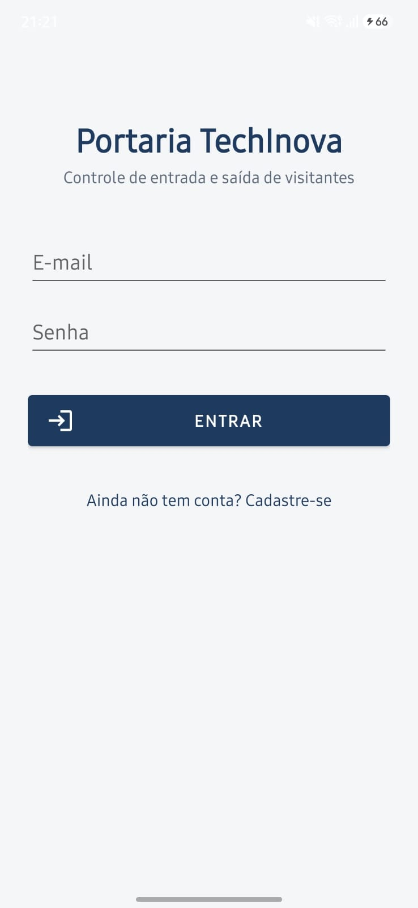
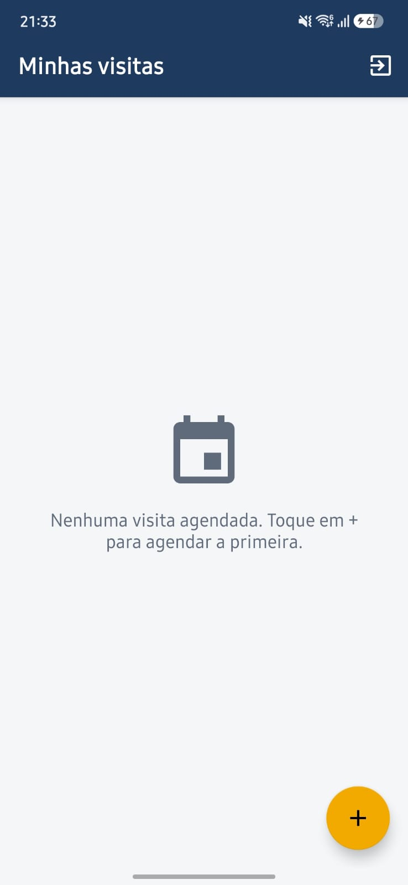
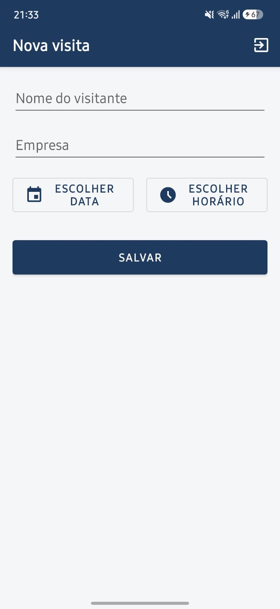
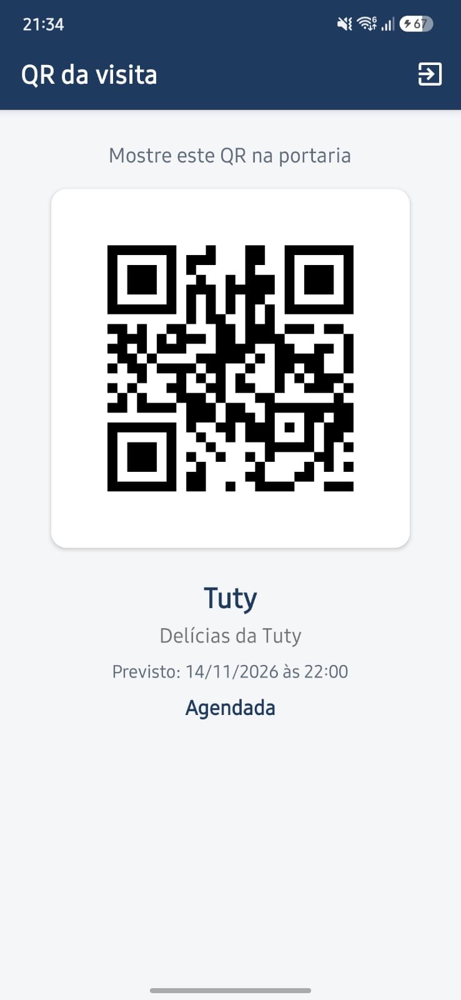
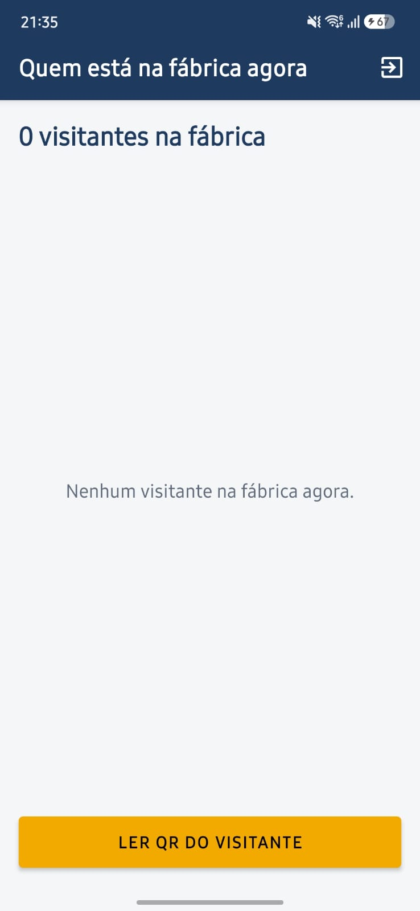
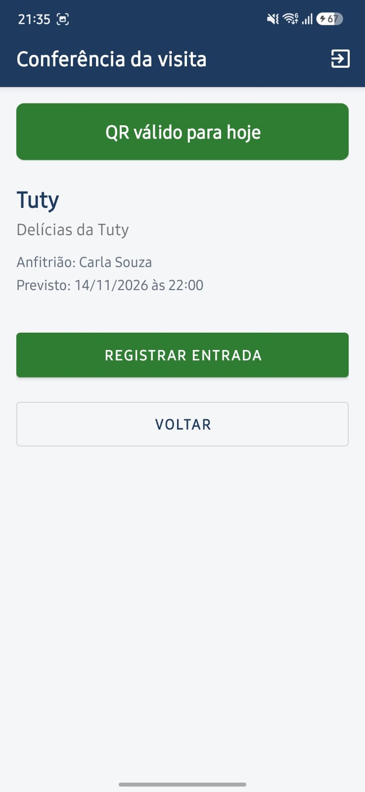
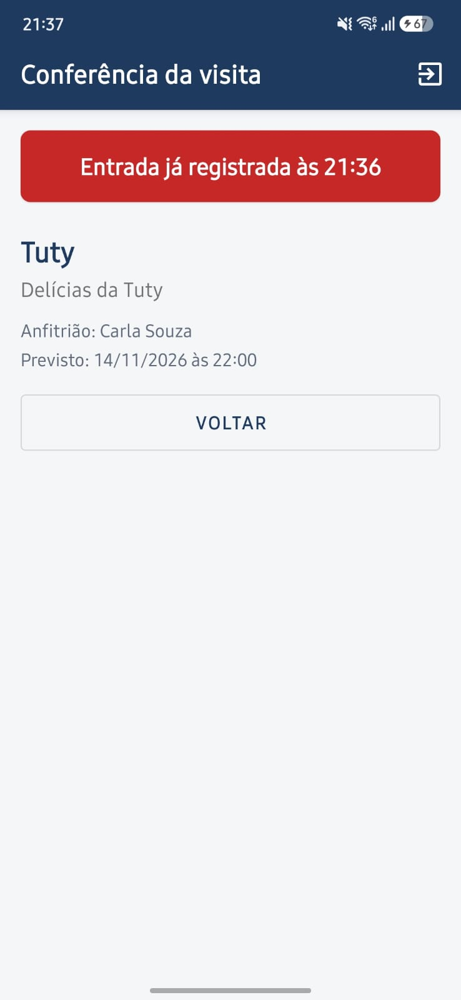

# Portaria TechInova — Portaria e Visitantes

App Android (Java + Firebase) para o controle de entrada e saída de visitantes da fábrica.
Projeto 10 da atividade **TechInova: apps para o chão de fábrica** — Desenvolvimento de Aplicativos Móveis.

## Integrantes

| Integrante | Frente | Issues |
| --- | --- | --- |
| Débora Fraga | Base, login, roteador, regras, saída, README | #1, #2, #3, #7, #11, #12 |
| Isabelle Morales | Anfitrião: agendar visita, Minhas visitas, QR da visita | #4, #5, #8 |
| Mirela de Melo | Porteiro: Quem está agora, leitura do QR, validade da entrada | #6, #9, #10 |

## O problema

O visitante chega, o porteiro liga para o ramal do anfitrião, ninguém atende e o visitante espera vinte minutos.
Na saída, ninguém registra. Se houver uma evacuação, a portaria não sabe quem está dentro da fábrica.

## A solução

O anfitrião agenda a visita no app e recebe um **QR code**. Na portaria, o porteiro lê o QR, confere os dados e
registra a entrada com um toque. Na saída, registra a saída. A tela **"Quem está na fábrica agora"** mostra,
em tempo real, todos os visitantes que estão dentro.

| Perfil | O que faz |
| --- | --- |
| **Anfitrião** | Agenda visitas, vê as próprias visitas e mostra o QR ao visitante |
| **Porteiro** | Lê o QR, confere os dados, registra entrada e saída e vê quem está na fábrica |

O perfil fica em `usuarios/{uid}` e é definido pelo grupo no console do Firebase, nunca pelo próprio usuário.

## Telas

> Coloque os prints em `docs/prints/` com os nomes abaixo.

| Login | Minhas visitas | Nova visita | QR da visita |
| --- | --- | --- | --- |
|  |  |  |  |

| Quem está na fábrica | Conferência: QR válido | Conferência: QR recusado | Registrar saída |
| --- | --- | --- | --- |
|  |  |  |  |

## Histórias de usuário (requisitos CORE)

Os critérios de aceite completos estão no corpo de cada issue.

| ID | História | Issue |
| --- | --- | --- |
| C1 | Como anfitrião, quero cadastrar a visita com nome, empresa, data e horário para que a portaria saiba quem espero. | #4 |
| C2 | Como anfitrião, quero um QR da visita para mostrar ou enviar ao visitante. | #8 |
| C3 | Como porteiro, quero ler o QR e conferir os dados para liberar a entrada sem ligar para o ramal. | #9 |
| C4 | Como porteiro, quero que o QR só valha no dia marcado e uma única vez para evitar entradas indevidas. | #10 |
| C5 | Como porteiro, quero registrar a saída para que a lista de presentes fique correta. | #11 |
| C6 | Como porteiro, quero ver ao vivo quem está dentro para saber quem evacuar numa emergência. | #6 |

## Tecnologias

- Android (Java), template Empty Views Activity, minSdk 33, targetSdk 36
- Firebase Authentication (e-mail e senha)
- Cloud Firestore com snapshot listeners e transações
- ZXing (`com.journeyapps:zxing-android-embedded:4.3.0`) para gerar e ler o QR
- RecyclerView, ConstraintLayout e Material Components

## Estrutura do projeto

```
br.senai.portaria
├── model/          Visita, Usuario
├── data/           VisitaRepository (consultas e transações)
├── util/           Datas, ErrosFirebase
└── ui/
    ├── RoteadorActivity          abre a tela de acordo com o perfil
    ├── BaseLogadaActivity        menu Sair das telas logadas
    ├── auth/       LoginActivity, CadastroActivity
    ├── anfitriao/  MinhasVisitasActivity, NovaVisitaActivity, VisitaDetalheActivity, VisitaAdapter
    └── porteiro/   PresentesActivity, ConferenciaActivity, PresenteAdapter
```

## Modelo de dados (Cloud Firestore)

**`usuarios/{uid}`** — criado pelo grupo no console

| Campo | Tipo | Exemplo |
| --- | --- | --- |
| `nome` | string | Carla Souza |
| `perfil` | string | `anfitriao` ou `porteiro` |

**`visitas/{id}`** — id automático

| Campo | Tipo | Quem grava |
| --- | --- | --- |
| `nomeVisitante`, `empresa` | string | Anfitrião |
| `anfitriaoUid`, `anfitriaoNome` | string | Anfitrião |
| `data` | string `yyyy-MM-dd` | Anfitrião |
| `horaPrevista` | string `HH:mm` | Anfitrião |
| `status` | string `AGENDADA` → `DENTRO` → `SAIU` | Anfitrião cria, porteiro altera |
| `criadaEm` | timestamp do servidor | Anfitrião |
| `entradaEm`, `porteiroEntradaUid` | timestamp / string | Porteiro (entrada) |
| `saidaEm`, `porteiroSaidaUid` | timestamp / string | Porteiro (saída) |

Entrada e saída usam **transação** (`runTransaction`): o app relê a visita no servidor antes de gravar,
então dois porteiros lendo o mesmo QR ao mesmo tempo não geram duas entradas.

## Como configurar o Firebase

O arquivo `google-services.json` **não** está no repositório. Para rodar o app:

1. Crie um projeto em [console.firebase.google.com](https://console.firebase.google.com).
2. Registre um app Android com o pacote **`br.senai.portaria`**.
3. Baixe o `google-services.json` e coloque em `app/`, ao lado do `build.gradle.kts`.
4. **Authentication** → Sign-in method → ative **E-mail/senha**.
5. **Firestore Database** → crie o banco na região `southamerica-east1`.
6. **Regras**: copie o conteúdo de [`firestore.rules`](firestore.rules) para a aba Regras e publique.
7. **Índices compostos** (Firestore → Índices → Compostos → Criar índice):

   | Coleção | Campo 1 | Campo 2 | Usado em |
   | --- | --- | --- | --- |
   | `visitas` | `anfitriaoUid` crescente | `data` decrescente | Minhas visitas |
   | `visitas` | `status` crescente | `entradaEm` crescente | Quem está na fábrica agora |

8. **Contas**: em Authentication → Users, crie as contas de teste abaixo. Depois, em Firestore, crie a coleção
   `usuarios` com **um documento para cada conta, usando o UID da conta como ID do documento**, com os campos
   `nome` e `perfil`.
9. Abra o projeto no Android Studio, faça o Sync do Gradle e rode.

## Contas de teste

| Perfil | E-mail | Senha | Nome |
| --- | --- | --- | --- |
| Anfitrião | `anfitriao@techinova.com` | `teste123` | Carla Souza |
| Anfitrião | `anfitriao2@techinova.com` | `teste123` | Marcos Ribeiro |
| Porteiro | `porteiro@techinova.com` | `teste123` | João Batista |

Uma conta criada pelo Cadastro do app só funciona depois que o grupo cria o documento dela em `usuarios`.
Até lá, o app mostra "Sua conta ainda não foi liberada" com o UID da conta.

## Regras de segurança

Resumo do que o arquivo [`firestore.rules`](firestore.rules) garante:

- Sem login, nada é lido nem gravado.
- `usuarios`: cada pessoa lê só o próprio documento; o app nunca grava (perfil só pelo console).
- Anfitrião lê e cria só as próprias visitas, sempre com status `AGENDADA`.
- Porteiro lê todas as visitas e só pode fazer `AGENDADA → DENTRO` e `DENTRO → SAIU`, alterando apenas os campos de entrada ou saída.

!image.png !image.png !image.png

## Como trabalhamos (engenharia de software)

- **ES1 — Histórias:** cada requisito CORE é uma issue com história e critérios de aceite (Dado / Quando / Então).
- **ES2 — Backlog:** quadro no GitHub Projects com as colunas A fazer, Fazendo e Feito.
- **ES3 — Branch e pull request:** cada história em uma branch própria, com PR revisado e aprovado por outra integrante antes do merge (`Closes #N`).

## Checklist CORE e núcleo comum

| Requisito | Status | Observação |
| --- | --- | --- |
| NC1 Cadastro, login, sessão e sair | Feito | |
| NC2 Firestore com snapshot listener | Feito | Minhas visitas, Quem está agora e QR da visita |
| NC3 Regras de segurança por perfil | Feito | Testadas no Rules Playground |
| NC4 Perfil em `usuarios/{uid}` | Feito | Definido só pelo console |
| NC5 RecyclerView com estado vazio | Feito | |
| NC6 Formulários validados em português | Feito | |
| NC7 Girar a tela não apaga o que foi digitado | Feito | `onSaveInstanceState` para data e hora |
| NC8 README | Feito | |
| C1 Agendar visita | Feito | |
| C2 Gerar QR | Feito | |
| C3 Ler QR e registrar entrada | Feito | |
| C4 QR só no dia marcado e uma única vez | Feito | Transação no Firestore |
| C5 Registrar saída | Feito | Transação no Firestore |
| C6 Quem está na fábrica agora | Feito | Tempo real |

## Limitações e próximos passos

- A data do QR é comparada com o relógio do aparelho do porteiro; um relógio errado pode aceitar ou recusar indevidamente.
- No Android 15 ou superior o app desenha atrás das barras do sistema (edge-to-edge obrigatório); as telas usam `fitsSystemWindows` para o conteúdo não ficar escondido.
- Próximos passos: compartilhar o QR como imagem, aviso ao anfitrião quando o visitante entra, histórico de visitas por empresa e foto do visitante.

## Entrega

- APK de debug: aba **Releases**
- Vídeo da demonstração: _link não listado_
- Slides em PDF: _link_
